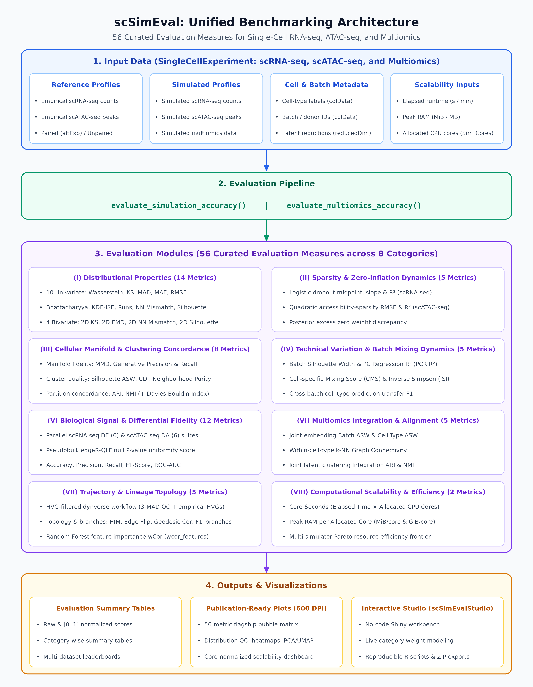
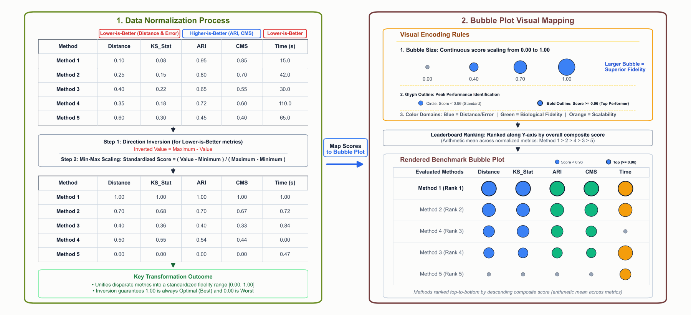

# Interactive Single-Cell & Multiomics Simulation Benchmarking with scSimEvalStudio

## 1. Scientific Motivation & Multiomics Experimental Design Coverage

Single-cell and multiomics simulation algorithms are foundational to computational biology: they enable method developers and applied bioinformaticians to benchmark clustering, batch integration, differential expression/accessibility, trajectory inference, and cross-modal alignment algorithms under controlled ground-truth conditions. However, any *in silico* benchmark is only as trustworthy as the biological realism of its underlying synthetic datasets. A simulator that reproduces marginal gene means while distorting zero-inflation kinetics, collapsing rare cell manifolds, inflating false-positive differential markers, or decoupling chromatin accessibility from transcription can systematically mislead downstream tool selection.

**`scSimEvalStudio`** (version `0.99.3`) is the interactive Shiny graphical studio companion to **[`scSimEval`](https://kabilanbio.github.io/scSimEval/)** (version `0.99.12`). Together, they establish a rigorous, reference-based benchmarking framework that compares one or more simulated datasets ($\mathcal{D}_{\text{sim}}^{(1)}, \dots, \mathcal{D}_{\text{sim}}^{(M)}$) against an empirical biological reference dataset ($\mathcal{D}_{\text{ref}}$) across **56 curated evaluation measures** organized into **8 canonical biological and computational categories**.

### Bioconductor Ecosystem Integration & S4 Data Structures

`scSimEvalStudio` is engineered directly around Bioconductor S4 data representations and statistical infrastructure:

- **Core S4 Container (`SingleCellExperiment`)**: All evaluation workflows operate natively on [`SingleCellExperiment`](https://bioconductor.org/packages/SingleCellExperiment/) objects storing raw count matrices in `assay(sce, "counts")` (supporting memory-efficient sparse `dgCMatrix` representations from the `Matrix` package) and cell-level biological annotations (`cell_type` and `batch`) in `SummarizedExperiment::colData(sce)`.
- **Multi-Modal Co-Assay Representation (`altExp`)**: Paired multiomics datasets (`scRNA-seq + scATAC-seq` profiled across identical cell barcodes) are represented either as a single `SingleCellExperiment` containing the secondary chromatin accessibility assay in `altExp(sce, "ATAC")` or as a named list `list(RNA = rna_sce, ATAC = atac_sce)`.
- **Automatic `Seurat` Interoperability**: Users working with `Seurat` objects can convert them in one line via `Seurat::as.SingleCellExperiment(seurat_obj)` prior to saving, or upload `.rds` files containing `Seurat` objects directly into `scSimEvalStudio` for automatic on-the-fly S4 conversion.
- **Statistical & Parallel Backends**: Integrates with `BiocParallel` for dynamic multi-core task scheduling, `edgeR` for replicate-aware pseudobulk quasi-likelihood differential testing (`glmQLFit` / `glmQLFTest`), `CDI` for penalized likelihood Clustering Deviation Index computation, `CellMixS` for cell-specific batch mixing, and `scater` / `scuttle` for single-cell normalization and quality control.

### Coverage Across Four Experimental Designs

| Experimental Design | S4 Input Representation | `colData` Metadata | Active Categories | Curated Measures Evaluated |
|:---|:---|:---|:---:|:---:|
| **1. Unimodal `scRNA-seq`** | Gene $\times$ cell raw UMI/read count matrix in `assay(sce, "counts")` | `cell_type` (Cat III, V) & `batch` (Cat IV, V) | **7 Categories** (I–V, VII, VIII) | **44 Measures** (Cat I: 14, Cat II: 4, Cat III: 8, Cat IV: 5, Cat V: 6 DE, Cat VII: 5 Trajectory, Cat VIII: 2 Scalability) |
| **2. Unimodal `scATAC-seq`** | Peak/bin $\times$ cell raw fragment/insertion count matrix in `assay(sce, "counts")` with TF-IDF latent semantic indexing | `cell_type` (Cat III, V) & `batch` (Cat IV, V) | **6 Categories** (I–V, VIII) | **38 Measures** (Cat I: 14, Cat II: 3, Cat III: 8, Cat IV: 5, Cat V: 6 DA, Cat VIII: 2 Scalability; Cat VII skipped for ATAC) |
| **3. Paired Co-Assay Multiomics** | Joint `scRNA-seq + scATAC-seq` across identical cells (1-to-1 barcode correspondence via `altExp(sce, "ATAC")` or `list(RNA = rna_sce, ATAC = atac_sce)`) | Shared `cell_type` & `batch` | **All 8 Categories** (I–VIII) | **56 Measures** *(rendered as 50 unique columns in the Comparative Bubble Matrix)* |
| **4. Unpaired Multiomics** | Independent `scRNA-seq` and `scATAC-seq` `SingleCellExperiment` objects from the same tissue without shared barcodes | Modality-specific `cell_type` & `batch` | **All 8 Categories** (I–VIII) | **56 Measures** *(Cat VI evaluated on joint stacked latent embeddings; 50 Bubble Matrix columns)* |

------------------------------------------------------------------------

## 2. End-to-End Architecture & The 8-Category / 56-Measure Taxonomy

The benchmarking engine underlying `scSimEvalStudio` executes a four-stage scientific pipeline:



### Detailed Scientific Breakdown of Categories I–VIII

#### Category I: Distributional Properties (14 Measures Across 18 Empirical Properties)

Category I evaluates whether synthetic count matrices reproduce both marginal (1D) and joint (2D) statistical distributions of real cells and features across **18 empirical summary properties**:

- **7 Univariate Cell-Level Properties (`extract_cell_properties()`)**: `library_size`, `log_library_size`, `tmm_factor`, `zero_fraction_cell`, `detection_freq_cell`, `cell_cor`, and `pca_dist`.
- **7 Univariate Feature-Level Properties (`extract_feature_properties()`)**: `mean_expression`, `variance`, `scaled_variance`, `cv`, `zero_fraction_feature`, `dispersion`, and `gene_cor`.
- **4 Bivariate Property Couplings**: `lib_vs_cellzero`, `mean_vs_sd`, `mean_vs_featzero`, and `mean_vs_dispersion`.

Across the 14 univariate properties, `scSimEval` computes **10 complementary 1D divergence measures**: `Wasserstein`, `KS`, `MAD`, `MAE`, `RMSE`, `Bhattacharyya`, `KDE_ISE`, `Runs_Statistic`, `NN_Mismatch`, and `Between_Dataset_Silh_Global`. Across the 4 bivariate pairs, it computes **4 two-dimensional divergence measures**: `Fasano_Franceschini_2D_KS`, `EMD_2D`, `NN_Mismatch_2D`, and `Between_Dataset_Silh_2D_Global`.

#### Category II: Sparsity & Zero-Inflation Dynamics (5 Measures)

Evaluates logistic dropout probability kinetics $P(\text{zero}_g \mid \mu_g) = [1 + \exp(-k(\mu_g - x_0))]^{-1}$ (`midpoint_error`, `slope_error`, `r2_discrepancy`), scATAC-seq quadratic accessibility-sparsity curve residual error (`curve_rmse`), and technical excess zero-inflation weight divergence (`excess_zero_weight_discrepancy`).

#### Category III: Cellular Manifold & Clustering Concordance (8 Measures)

Evaluates high-dimensional latent manifold geometry and clustering fidelity via multi-scale RBF kernel Maximum Mean Discrepancy (`MMD`), $k$-NN manifold support `Generative_Precision` and `Generative_Recall`, cell-type Average Silhouette Width (`silhouette_sim`), Clustering Deviation Index (`cdi`), local $k$-NN `neighborhood_purity`, Adjusted Rand Index (`ari`), and Normalized Mutual Information (`nmi`).

#### Category IV: Technical Variation & Batch Mixing Dynamics (5 Measures)

Quantifies technical batch confounder preservation and local neighborhood intermixing via `batch_silhouette`, Principal Component Regression variance explained (`pcr_r2`), Cell-Specific Mixing Score (`cms`), Local Inverse Simpson's Index (`isi`), and held-out `cross_batch_F1` transfer classification.

#### Category V: Biological Signal & Differential Fidelity (12 Measures: 6 scRNA-seq DE + 6 scATAC-seq DA)

Aggregates single cells into biological replicate **cell-type $\times$ batch pseudobulks** (`to_pseudobulk()`) and fits negative binomial quasi-likelihood models (`edgeR::glmQLFit` / `glmQLFTest`) with cellular detection rate covariates (`run_edger_qlf_detrate()` for scRNA-seq; binarized peak accessibility `binarize_matrix()` + `run_edger_qlf_da()` for scATAC-seq). Computes 6 scRNA-seq DE and 6 scATAC-seq DA measures: `pval_dist_score`, `accuracy`, `precision`, `recall`, `f1_score`, and `auc` (ROC-AUC).

#### Category VI: Multiomics Integration & Alignment (5 Measures)

Evaluates cross-modal alignment in joint RNA + ATAC latent space via Cross-Modal Batch ASW (`batch_asw`), Joint Cell-Type ASW (`cell_type_asw`), $k$-NN Graph Connectivity (`graph_connectivity`), Integration ARI (`ari`), and Integration NMI (`nmi`).

#### Category VII: Trajectory & Lineage Topology (5 Measures)

Executes HVG-filtered `dynverse` milestone trajectory inference on scRNA-seq (`preprocess_trajectory_hvgs()`, `infer_dynverse_trajectory()`) and evaluates Hamming–Ipsen–Mikhailov graph topology similarity (`him`), `edge_flip` graph edit similarity, pairwise pseudotime `geodesic_correlation`, branch assignment `F1_branches`, and Ranger Random Forest driver gene importance weighted correlation (`wcor_features`).

#### Category VIII: Computational Scalability & Efficiency (2 Hardware-Normalized Measures)

Standardizes computational resource consumption across heterogeneous CPU allocations via **Cumulative Core-Seconds** ($\text{Core-Seconds} = T_{\text{elapsed, seconds}} \times N_{\text{cores}}$, `core_seconds`) and **Peak RAM per Allocated Core** ($\text{Peak RAM per Core} = M_{\text{peak, MiB}} / N_{\text{cores}}$, `memory_per_core_mib`).

------------------------------------------------------------------------

## 3. Direction-Aware Score Normalization & Hierarchical Aggregation



`scSimEvalStudio` normalizes raw measurements (`Score_Raw`) via `scSimEval::normalize_bubble_scores()` onto a direction-aligned $[0, 1]$ fidelity scale ($1.00 =$ ideal biological reference concordance), averages constituent metrics within each active category $k$ ($S_{\text{cat}, m, k} = \frac{1}{|\mathcal{M}_k|}\sum_{j \in \mathcal{M}_k} s_{m,j}$), and computes the unweighted **Overall Composite Score** ($S_{\text{overall}, m} = \frac{1}{K}\sum_{k=1}^{K} S_{\text{cat}, m, k}$).

------------------------------------------------------------------------

## 4. Detailed Guide to All 8 Interactive Modules in `scSimEvalStudio`

1. **Module 1 (`Home`)**: Executive KPI ribbon (56 measures, 8 categories, 3 modality classes, $[0.0, 1.0]$ scale), 8-category overview grid, and 3-stage pipeline navigation.
2. **Module 2 (`Data Hub`)**: Four isolated ingestion modes (`scRNA-seq`, `scATAC-seq`, `Paired & Unpaired Multiomics`, and `Upload Saved Results [.rds / .csv]`), 1-click *Oryza sativa* Rice Bud (6 simulators) and *Glycine max* Soybean Root (3 simulators) empirical benchmarks, custom `.rds` evaluation, incremental benchmark appending, and a **1-Click Standalone HPC/Workstation R Script Generator**.
3. **Module 3 (`Comparative Bubble Matrix`)**: Flagship dual-encoded Bubble Matrix (`plot_benchmark_bubble_matrix()`) and interactive **Fidelity Leaderboard** (`compute_method_leaderboard()`).
4. **Module 4 (`Visualizations` — 8 Diagnostic Sub-Panels)**: (1) Evaluation Summary, (2) Distribution QC across all 18 properties, (3) Metric Heatmap, (4) Metric Plots, (5) PCA Ordination anchored to the Ideal Reference Anchor $\mathbf{1}$, (6) MDS Metric Space, (7) Cell Embeddings (UMAP, t-SNE & PCA with ASW & ARI quality table), and (8) Scalability Benchmark (`core_seconds` and `MiB/core`), all equipped with the **25%–400% Step-Zoom, Drag-to-Pan & 600% Fullscreen Lightbox** viewer.
5. **Module 5 (`Benchmark Results & Export`)**: Reproducible `.rds` session export, filterable `DT` master table (`Score_Raw` and `Score`), and multi-sheet Excel (`.xlsx`) and `.csv` downloads.
6. **Module 6 (`Help & Getting Started`)**: Interactive workflow diagrams, S4 `SingleCellExperiment` preparation recipes, and the **Dynamic Multi-Core Scheduling Table**.
7. **Module 7 (`Logs`)**: Live WebSocket diagnostic terminal (`sc_live_log`) streaming `INFO`, `NOTE`, `WARNING`, `ERROR`, and `SUCCESS` events with search, filtering, and `.txt` export.
8. **Module 8 (`Contact`)**: Institutional attribution and research team directory at the Division of Agricultural Bioinformatics, ICAR-IASRI, New Delhi.

------------------------------------------------------------------------

## 5. Installation, Launching & Programmatic Verification

``` r
if (!requireNamespace("BiocManager", quietly = TRUE)) {
    install.packages("BiocManager")
}
BiocManager::install(c("scSimEval", "scSimEvalStudio"))
```

Launch the Shiny studio:

``` r
library(scSimEvalStudio)
launch_scSimEval_app()
```

Verify application initialization and inspect the bundled 6-simulator benchmark database:

``` r
library(scSimEvalStudio)

app_dir <- system.file("shiny", "scSimEvalApp", package = "scSimEvalStudio")
dir.exists(app_dir)
#> [1] TRUE

app <- shiny::shinyAppDir(app_dir)
class(app)
#> [1] "shiny.appobj"

demo_file <- file.path(app_dir, "data", "demo_benchmark_data.rds")
demo_obj <- readRDS(demo_file)
names(demo_obj)
#> [1] "benchmark_df"            "benchmark_summary_table"
#> [3] "dataset_summary_df"      "methods"
demo_obj$methods
#> [1] "scMultiSim" "scDesign3"  "MOSim"      "scCross"    "scMoMtF"   
#> [6] "Matilda"
head(demo_obj$benchmark_summary_table[, c("Method", "Category", "Metric", "Score")], 6)
#>                  Method                      Category         Metric     Score
#> scMultiSim.1 scMultiSim (I) Distributional Properties    Wasserstein 0.7190470
#> scMultiSim.2 scMultiSim (I) Distributional Properties             KS 0.5516079
#> scMultiSim.3 scMultiSim (I) Distributional Properties            MAD 0.0000000
#> scMultiSim.4 scMultiSim (I) Distributional Properties  Bhattacharyya 0.5304023
#> scMultiSim.5 scMultiSim (I) Distributional Properties Runs_Statistic 0.7451238
#> scMultiSim.6 scMultiSim (I) Distributional Properties    NN_Mismatch 0.6441069
```
