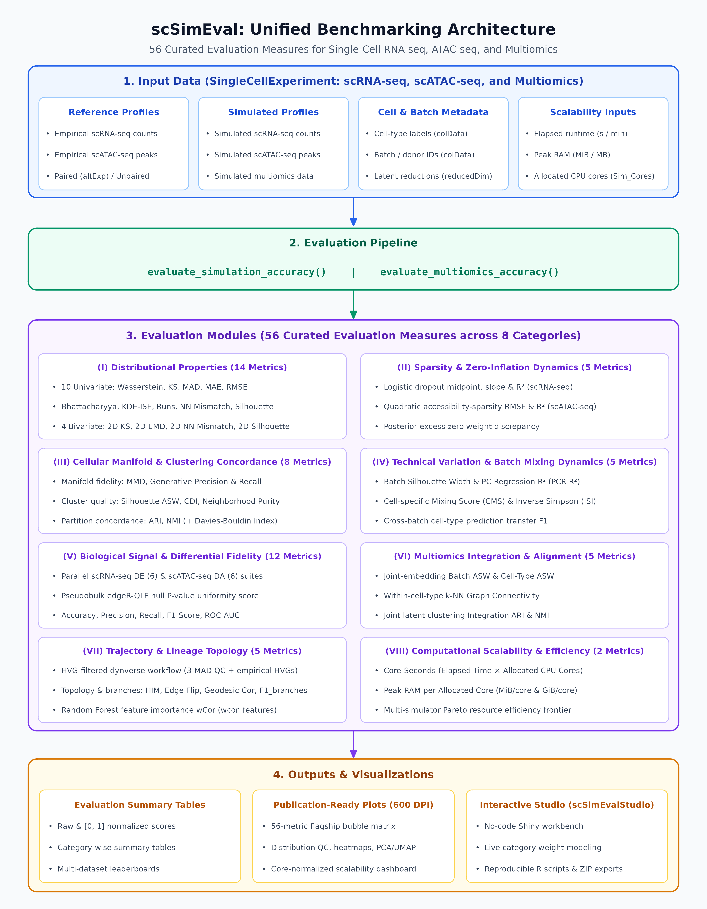
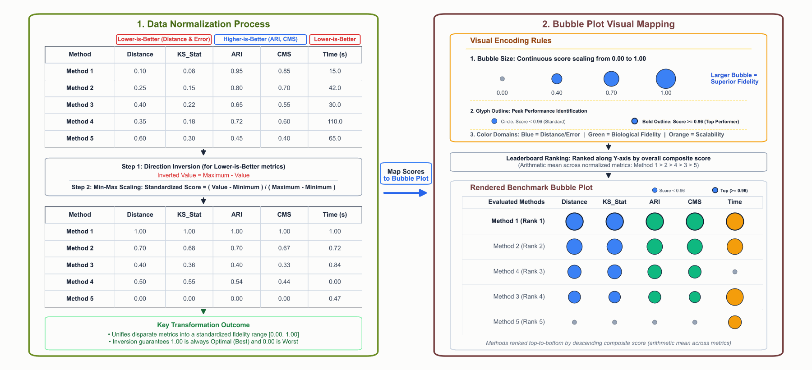

# scSimEvalStudio: Interactive Shiny Studio for Single-Cell Multiomics Simulation Benchmarking

[](https://opensource.org/licenses/MIT)
[](https://kabilanbio.github.io/scSimEvalStudio/)
[](https://bioconductor.org/packages/SingleCellExperiment/)
[](https://kabilanbio.github.io/scSimEval/)

------------------------------------------------------------------------

## 1. Scientific Overview & Multiomics Experimental Design Coverage

**`scSimEvalStudio`** (version `0.99.3`) is the interactive graphical benchmarking studio companion to **[`scSimEval`](https://kabilanbio.github.io/scSimEval/)** (version `0.99.12`). Single-cell and multiomics simulation algorithms are indispensable for benchmarking computational methods, conducting *in silico* power analyses, and evaluating data integration pipelines. However, synthetic datasets only provide valid benchmarks if they faithfully recapitulate the statistical distributions, technical dropout kinetics, high-dimensional cellular manifolds, batch confounder structure, differential regulatory signals, lineage topology, and cross-modal coupling of empirical biological tissues.

`scSimEvalStudio` operationalizes reference-based simulation benchmarking by comparing one or more synthetic datasets ($\mathcal{D}_{\text{sim}}^{(1)}, \dots, \mathcal{D}_{\text{sim}}^{(M)}$) directly against an empirical biological reference dataset ($\mathcal{D}_{\text{ref}}$) across **56 curated quantitative evaluation measures** organized into **8 canonical biological and computational categories**.

### Supported Single-Cell & Multiomics Experimental Designs

Built natively on Bioconductor **`SingleCellExperiment`** S4 containers (with automatic one-line conversion from `Seurat` objects via `Seurat::as.SingleCellExperiment()`), `scSimEvalStudio` supports four experimental design architectures:

| Experimental Design | Primary Assay & S4 Representation | Required `colData` Annotations | Active Categories | Curated Measures Evaluated |
| :--- | :--- | :--- | :---: | :---: |
| **1. Unimodal `scRNA-seq`** | Gene $\times$ cell raw UMI/read count matrix (`assay(sce, "counts")`, sparse `dgCMatrix`) | `cell_type` (Cat III, V) & `batch` (Cat IV, V) | **7 Categories** (I–V, VII, VIII) | **44 Measures** |
| **2. Unimodal `scATAC-seq`** | Peak/bin $\times$ cell raw chromatin fragment/insertion matrix (`assay(sce, "counts")`) with TF-IDF latent semantic indexing | `cell_type` (Cat III, V) & `batch` (Cat IV, V) | **6 Categories** (I–V, VIII) | **38 Measures** |
| **3. Paired Co-Assay Multiomics** | Simultaneous `scRNA-seq + scATAC-seq` across identical cell barcodes (1-to-1 correspondence via `altExp(sce, "ATAC")` or `list(RNA = rna_sce, ATAC = atac_sce)`) | Shared `cell_type` & `batch` across paired barcodes | **All 8 Categories** (I–VIII) | **56 Measures** *(50 Bubble Matrix Columns)* |
| **4. Unpaired Multiomics** | Independent `scRNA-seq` and `scATAC-seq` `SingleCellExperiment` objects profiled from the same biological tissue without shared barcodes | Modality-specific `cell_type` & `batch` coupled in joint stacked latent space | **All 8 Categories** (I–VIII) | **56 Measures** *(50 Bubble Matrix Columns)* |

------------------------------------------------------------------------

## 2. End-to-End Architecture & The 8-Category / 56-Measure Taxonomy

`scSimEvalStudio` orchestrates a four-stage evaluation workflow connecting data ingestion, parallelized statistical estimation, direction-aware mathematical score normalization, and interactive visual analytics:



### Summary of the 8 Canonical Evaluation Categories (56 Measures)

| Category | Biological / Computational Domain | Measures | Statistical Formulation & Biological Scope |
| :---: | :--- | :---: | :--- |
| **I** | **Distributional Properties** | **14** | **10 univariate (1D)** distances (`Wasserstein`, `KS`, `MAD`, `MAE`, `RMSE`, `Bhattacharyya`, `KDE_ISE`, `Runs_Statistic`, `NN_Mismatch`, `Between_Dataset_Silh_Global`) and **4 bivariate (2D)** distances (`Fasano_Franceschini_2D_KS`, `EMD_2D`, `NN_Mismatch_2D`, `Between_Dataset_Silh_2D_Global`) evaluated across **18 empirical properties**: 7 cell-level (`library_size`, `log_library_size`, `tmm_factor`, `zero_fraction_cell`, `detection_freq_cell`, `cell_cor`, `pca_dist`), 7 feature-level (`mean_expression`, `variance`, `scaled_variance`, `cv`, `zero_fraction_feature`, `dispersion`, `gene_cor`), and 4 bivariate pairs (`lib_vs_cellzero`, `mean_vs_sd`, `mean_vs_featzero`, `mean_vs_dispersion`). |
| **II** | **Sparsity & Zero-Inflation Dynamics** | **5** | Parametric logistic dropout kinetics $P(\text{zero} \mid \mu_g) = [1 + \exp(-k(\mu_g - x_0))]^{-1}$ (`midpoint_error` $ | \Delta x_0 | $, `slope_error` $ | \Delta k | $, goodness-of-fit `r2_discrepancy`), scATAC-seq quadratic accessibility-sparsity curve residual error (`curve_rmse`), and technical excess zero-inflation weight divergence (`excess_zero_weight_discrepancy`). |
| **III** | **Cellular Manifold & Clustering Concordance** | **8** | High-dimensional topology and unsupervised clustering fidelity: multi-scale RBF kernel Maximum Mean Discrepancy (`MMD`), k-NN manifold support `Generative_Precision` (penalizes hallucinated states) and `Generative_Recall` (penalizes mode collapse), cell-type Average Silhouette Width (`silhouette_sim`), penalized likelihood Clustering Deviation Index (`cdi`), local k-NN `neighborhood_purity`, Adjusted Rand Index (`ari`), and Normalized Mutual Information (`nmi`). |
| **IV** | **Technical Variation & Batch Mixing Dynamics** | **5** | Technical batch confounder preservation and local neighborhood intermixing: `batch_silhouette`, Principal Component Regression variance explained (`pcr_r2`), Cell-Specific Mixing Score (`cms`), Local Inverse Simpson's Index (`isi`), and held-out `cross_batch_F1` transfer classification. |
| **V** | **Biological Signal & Differential Fidelity** | **12** | Replicate-aware cell-type $\times$ batch pseudobulk aggregation (`to_pseudobulk()`) followed by negative binomial quasi-likelihood F-testing (`edgeR::glmQLFit` / `glmQLFTest`). Evaluates **6 scRNA-seq DE** and **6 binarized scATAC-seq DA** metrics: null $p$-value uniformity (`pval_dist_score`), binary `accuracy`, `precision`, `recall`, harmonic `f1_score`, and threshold-free ranking `auc` (ROC-AUC). |
| **VI** | **Multiomics Integration & Alignment** | **5** | Cross-modal joint latent space alignment (`scib`, `scMultiSim`, `scCross`, `Matilda`, `scMoMtF`): Cross-Modal `batch_asw`, Joint `cell_type_asw`, k-NN `graph_connectivity`, `integration_ari`, and `integration_nmi`. |
| **VII** | **Trajectory & Lineage Topology** | **5** | HVG-filtered `dynverse` milestone network inference on scRNA-seq: Hamming–Ipsen–Mikhailov graph topology similarity (`him`), `edge_flip` graph edit similarity, pairwise pseudotime `geodesic_correlation`, branch assignment `F1_branches`, and Ranger Random Forest driver gene importance weighted correlation (`wcor_features`). |
| **VIII** | **Computational Scalability & Efficiency** | **2** | Hardware-normalized computational cost across heterogeneous CPU allocations: Cumulative CPU execution work $\text{Core-Seconds} = T_{\text{elapsed}} \times N_{\text{cores}}$ (`core_seconds`) and per-core resident memory footprint $\text{Peak RAM per Core} = M_{\text{peak, MiB}} / N_{\text{cores}}$ (`memory_per_core_mib`). |

------------------------------------------------------------------------

## 3. Direction-Aware Mathematical Score Normalization & Hierarchical Aggregation

Raw evaluation measures span incompatible physical units and optimization directions. `scSimEvalStudio` transforms every raw measurement (`Score_Raw`) through a two-stage direction-aware normalization pipeline (`scSimEval::normalize_bubble_scores()`):



1. **Direction Alignment & $[0, 1]$ Fidelity Scaling**:
   - **Zero-targeted statistics** (`Runs_Statistic`, `Between_Dataset_Silh_Global`, `Between_Dataset_Silh_2D_Global`, `batch_silhouette`) are transformed via absolute divergence $d_{m,j} = |x_{m,j}|$.
   - **Lower-is-better distance, error, and resource cost metrics** ($d_{m,j} = x_{m,j}$ or $|x_{m,j}|$) are inverted and min-max normalized onto $[0, 1]$:
     $$s_{m,j} = \frac{\max_{m'} d_{m',j} - d_{m,j}}{\max_{m'} d_{m',j} - \min_{m'} d_{m',j} + \varepsilon} \in [0, 1]$$
   - **Higher-is-better concordance and classification metrics** (`ari`, `nmi`, `auc`, `f1_score`, `him`, `cms`, `isi`) are scaled directly onto $[0, 1]$:
     $$s_{m,j} = \frac{x_{m,j} - \min_{m'} x_{m',j}}{\max_{m'} x_{m',j} - \min_{m'} x_{m',j} + \varepsilon} \in [0, 1]$$
2. **Category-Level & Overall Composite Aggregation**:
   - Category means are computed across all evaluated measures $\mathcal{M}_k$ in category $k$: $S_{\text{cat}, m, k} = \frac{1}{|\mathcal{M}_k|} \sum_{j \in \mathcal{M}_k} s_{m,j}$.
   - The unweighted **Overall Composite Score** averages across all $K$ active categories: $S_{\text{overall}, m} = \frac{1}{K} \sum_{k=1}^{K} S_{\text{cat}, m, k}$.

------------------------------------------------------------------------

## 4. Overview of the 8 Interactive Modules in `scSimEvalStudio`

| Tab # | Module Name | Core Analytical & Diagnostic Capabilities |
| :---: | :--- | :--- |
| **1** | **Home** | Executive KPI ribbon (56 measures, 8 categories, 3 modality classes, $[0.0, 1.0]$ scale), 8-category overview grid, and 3-stage pipeline quick-jump controls. |
| **2** | **Data Hub** | **4 Ingestion Modes**: (1) `scRNA-seq`, (2) `scATAC-seq`, (3) `Paired & Unpaired Multiomics`, and (4) `Upload Saved Results (.rds / .csv)`. Includes 1-click *Oryza sativa* Rice Bud (6 simulators) and *Glycine max* Soybean Root (3 simulators) empirical benchmarks, custom `.rds` upload (`SingleCellExperiment` or auto-converted `Seurat`), per-simulator runtime/RAM/core inputs, incremental benchmark appending, and a **1-Click Standalone HPC/Workstation R Script Generator**. |
| **3** | **Comparative Bubble Matrix** | **Sub-Tab 1**: Flagship dual-encoded Bubble Matrix (`plot_benchmark_bubble_matrix()`) combining left-hand summary bars (Overall + Category I–VIII means) with right-hand metric circles, dataset/modality filters, custom metric pickers, 600 DPI JPEG/PDF export, and standalone R script download. **Sub-Tab 2**: Interactive **Fidelity Leaderboard** (`compute_method_leaderboard()`) with CSV export. |
| **4** | **Visualizations (8 Sub-Panels)** | **(1) Evaluation Summary**; **(2) Distribution QC** (Q-Q & 1D/2D kernel density plots across all 18 properties); **(3) Metric Heatmap**; **(4) Metric Plots**; **(5) PCA Ordination** (dual-panel simulator ordination & metric loading biplot anchored to the **Ideal Reference Anchor** $\mathbf{1}$); **(6) MDS Metric Space**; **(7) Cell Embeddings** (UMAP, t-SNE & PCA projections with ASW, ARI & library-depth table); and **(8) Scalability Benchmark** (4-panel runtime, peak RAM, Pareto trade-off & resource cost across `core_seconds` and `MiB/core`). |
| **5** | **Benchmark Results & Export** | Complete reproducible session `.rds` archive download, searchable `DT` master table displaying both `Score_Raw` and normalized `Score`, and multi-sheet Excel (`.xlsx`) and `.csv` report exports. |
| **6** | **Help & Getting Started** | Interactive zoomable workflow diagrams, S4 `SingleCellExperiment` data preparation recipes, and the **Dynamic Multi-Core Scheduling Table** detailing `BiocParallel` CPU allocation across Categories I–VIII. |
| **7** | **Logs** | Real-time WebSocket diagnostic terminal (`sc_live_log`) streaming `INFO`, `NOTE`, `WARNING`, `ERROR`, and `SUCCESS` events with live KPI counters, level filters, full-text search, clipboard copy, and `.txt` export. |
| **8** | **Contact** | Institutional attribution, research team directory at the Division of Agricultural Bioinformatics, ICAR-IASRI, New Delhi, and GitHub issue links. |

------------------------------------------------------------------------

## 5. Installation & Quick Start

``` r
if (!requireNamespace("BiocManager", quietly = TRUE)) {
    install.packages("BiocManager")
}
BiocManager::install(c("scSimEval", "scSimEvalStudio"))
```

To install the development version from GitHub:

``` r
if (!requireNamespace("remotes", quietly = TRUE)) {
    install.packages("remotes")
}
remotes::install_github("kabilanbio/scSimEval")
remotes::install_github("kabilanbio/scSimEvalStudio")
```

Launch the interactive studio:

``` r
library(scSimEvalStudio)
launch_scSimEval_app()
```

------------------------------------------------------------------------

## 6. Development, Citation & Support

`scSimEvalStudio` and `scSimEval` are developed and maintained at the **Division of Agricultural Bioinformatics, ICAR-Indian Agricultural Statistics Research Institute (ICAR-IASRI), New Delhi, India**.

- **Maintainer:** Kabilan Sakthivel (`kabilan151414@gmail.com`)
- **Studio Documentation (`scSimEvalStudio`):** <https://kabilanbio.github.io/scSimEvalStudio/>
- **Core Engine Documentation (`scSimEval`):** <https://kabilanbio.github.io/scSimEval/>
- **Source Code & Issue Tracker:** <https://github.com/kabilanbio/scSimEvalStudio/issues>
